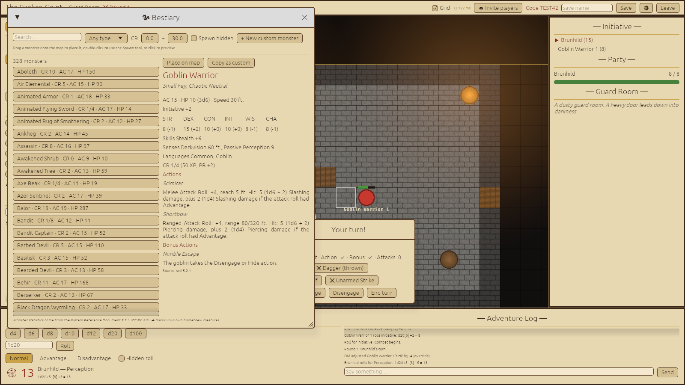
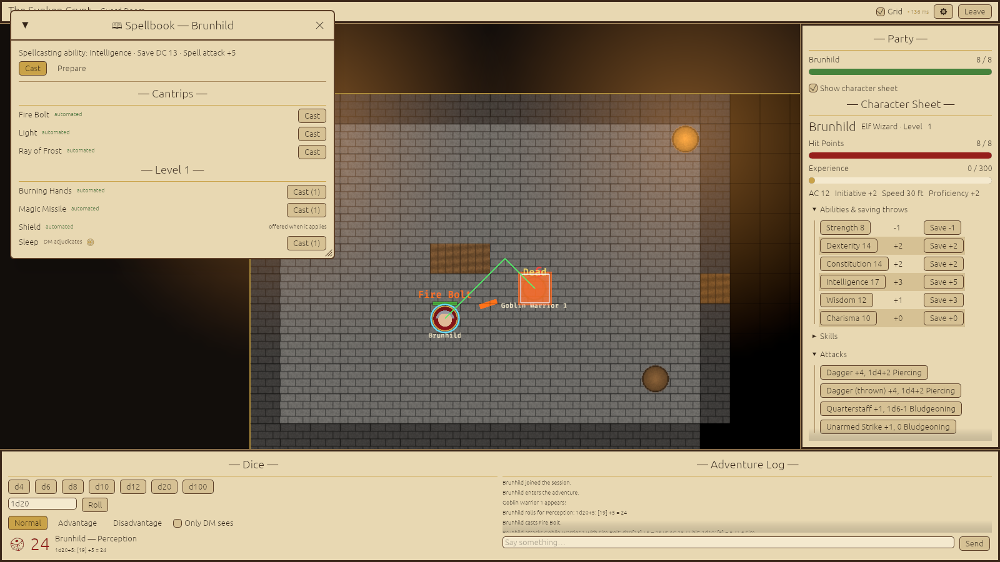
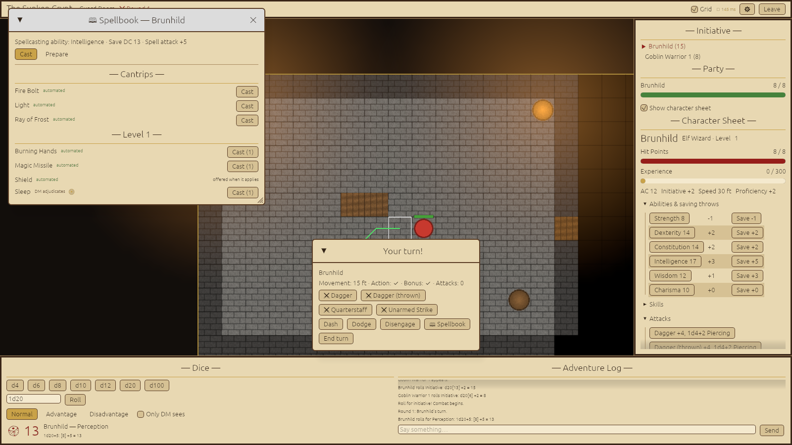
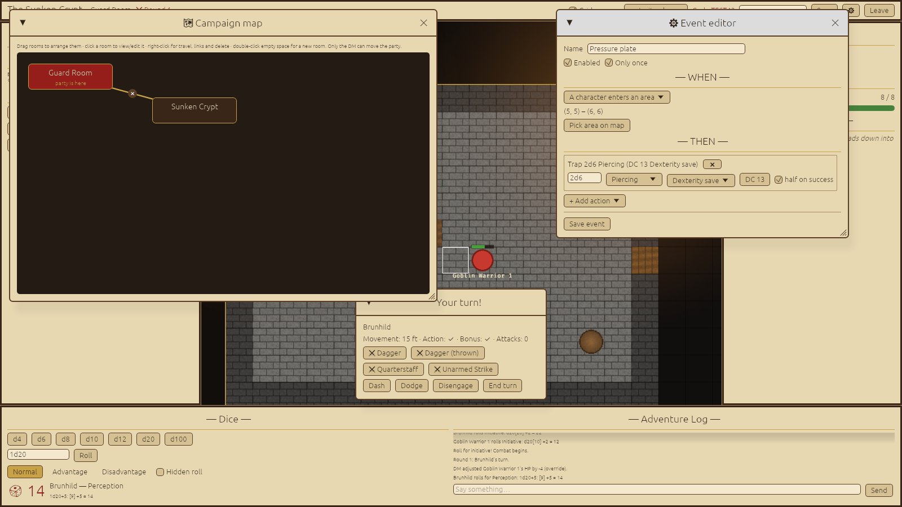
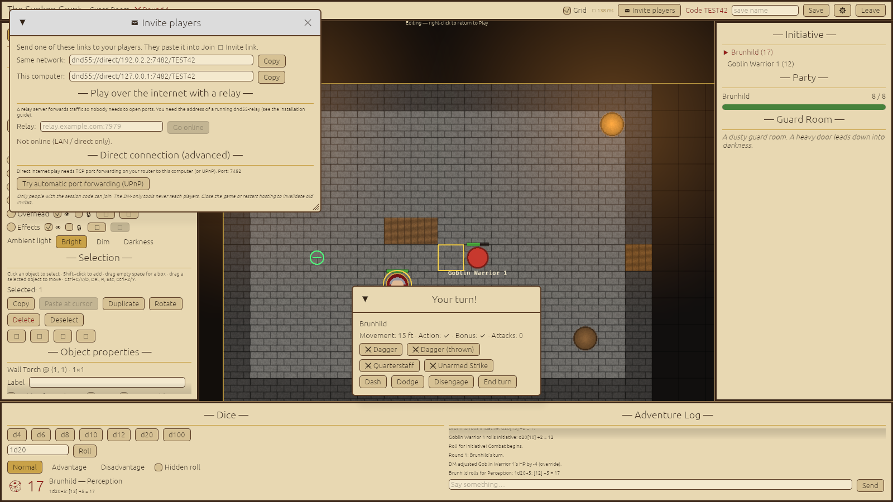

# DND55 — Multiplayer Desktop Tabletop RPG (5e 2024 rules, SRD 5.2.1)

A Rust desktop game for playing **fifth edition with the 2024 revised rules (SRD 5.2.1)** with friends.
The DM builds rooms on a grid, links them into a campaign map and hosts a live session. Players join
from their own PCs, on the same network or over the internet through a relay, with their own
characters. They explore under real light and darkness, cast spells and fight turn-based battles with
animated feedback.

**Windows users: start with [`WINDOWS_INSTALLATION_GUIDE.md`](WINDOWS_INSTALLATION_GUIDE.md).**



| Player casts Fire Bolt (clicked with real mouse input) | Spellbook (Wizard) |
|---|---|
|  |  |
| **Campaign map & event editor (DM)** | **Invites, selection & object properties (DM)** |
|  |  |

## What's in it

* **Rules:** 339 SRD spells (31 fully and 61 partly automated, the rest DM-adjudicated with full text);
  slots, Pact Magic, concentration, area templates, upcasting and reactions. Class features for all 12
  classes and the SRD subclasses, levels 1–20, rests and XP. 2024 combat: Weapon Mastery, opportunity
  attacks, conditions, death saves. See [`docs/RULES_COVERAGE.md`](docs/RULES_COVERAGE.md).
* **Bestiary:** 328 SRD monsters with search, filters, stat blocks, breath weapons with recharge, drag
  onto the map, and a homebrew monster editor.
* **Map editor:** tiles, objects and layers, selection with copy/paste/duplicate/rotate, a properties
  panel, chest loot, lights, undo/redo, and drawing tools.
* **Campaign map:** a visual room graph. Only the DM moves the party.
* **Scripted events without code:** traps, levers, chest rewards, boss-defeat unlocks, NPC dialogue
  with choices, skill checks.
* **Multiplayer:** authoritative host on the DM's PC. Hidden information never reaches players. Invite
  links work on LAN, via the `dnd55-relay` server, or with direct port forwarding/UPnP.
  Auto-reconnect.
* **Presentation:** dynamic lighting, darkvision, fog of war, spell VFX, floating damage, synthesized
  SFX, music and ambience, an EN/IT interface, and a medieval UI theme.
* **Windows:** `DND55.exe`, an installer and a portable zip. Saves go in `%APPDATA%\DND55`, with crash
  reports and automatic GPU-backend and no-audio fallbacks.

## Documentation

| Document | For |
|---|---|
| [`WINDOWS_INSTALLATION_GUIDE.md`](WINDOWS_INSTALLATION_GUIDE.md) | Installing/playing on Windows, building from source, multiplayer setup |
| [`docs/RELAY.md`](docs/RELAY.md) | Running a relay server (VPS/systemd/Docker), cost, security |
| [`docs/RULES_COVERAGE.md`](docs/RULES_COVERAGE.md) | What's automated, partial or DM-adjudicated |
| [`docs/ROADMAP.md`](docs/ROADMAP.md) | Status, how each item was verified, known limitations, next steps |
| [`docs/WINDOWS_ACCEPTANCE_CHECKLIST.md`](docs/WINDOWS_ACCEPTANCE_CHECKLIST.md) | Manual test pass on real Windows |
| [`docs/DESIGN.md`](docs/DESIGN.md) | Architecture |
| [`docs/LEGAL.md`](docs/LEGAL.md) | SRD attribution and asset licensing |

## Build & run (developers)

Requirements: Rust (the pinned toolchain in `rust-toolchain.toml` installs automatically via rustup).
Windows needs the MSVC build tools (see the guide, Method B). Linux needs
`libasound2-dev libudev-dev libxkbcommon-dev` and Vulkan drivers.

```bash
cargo run --release -p dnd_desktop        # the game
cargo run --release -p dnd_relay          # a relay server on 0.0.0.0:7979
```

Windows packages from Linux (MinGW + NSIS): `scripts/build-windows-from-linux.sh`. On Windows: `scripts\build-windows.ps1`.

## Tests

```bash
cargo test --workspace                     # 150+ tests
cargo clippy --workspace --all-targets     # clean
scripts/gui-click-test.sh                  # Linux: real mouse input in two game windows (Xvfb + xdotool)
```

The GUI harness (`DND55_AUTO=host|join`, `DND55_AUTO_OPEN=bestiary,spellbook,…`,
`DND55_SCREENSHOT=…`) is documented in `apps/dnd_desktop/src/autotest.rs`.

## Workspace

| Crate | Purpose |
|---|---|
| `crates/dnd_rules` | Pure SRD 5.2.1 rules engine: abilities, combat, spells, classes, monsters, items (no graphics/IO) |
| `crates/dnd_world` | Maps, layers, asset catalog, pathfinding, line of sight, lighting, room graph |
| `crates/dnd_session` | Authoritative session: command validation, combat, spells, features, scripts, per-player views |
| `crates/dnd_persist` | SQLite saves with checksums, migrations, autosave, backup, export/import |
| `crates/dnd_net` | TCP host/client, invites, relay client, UPnP, session codes, resume tokens, rate limiting |
| `crates/dnd_relay` | `dnd55-relay`: rendezvous + byte relay for internet play without port forwarding |
| `apps/dnd_desktop` | Bevy + egui client (`DND55.exe`): menus, editor, HUD, rendering, audio, i18n EN/IT |
| `content/`, `tools/` | SRD data (spells, monsters, class tables/features) and the scripts that extract/validate it from the SRD PDF |

---

This work includes material from the System Reference Document 5.2.1 ("SRD 5.2.1") by Wizards of the
Coast LLC, available at https://www.dndbeyond.com/srd. The SRD 5.2.1 is licensed under the Creative
Commons Attribution 4.0 International License, available at
https://creativecommons.org/licenses/by/4.0/legalcode.
