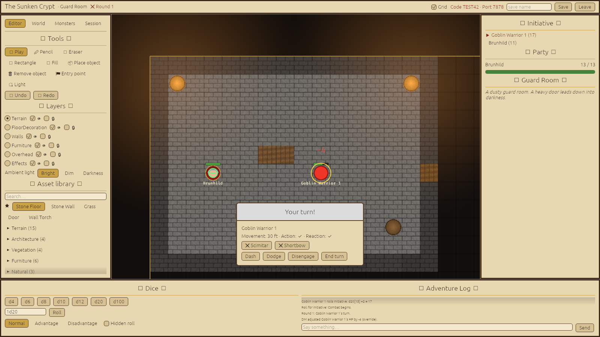
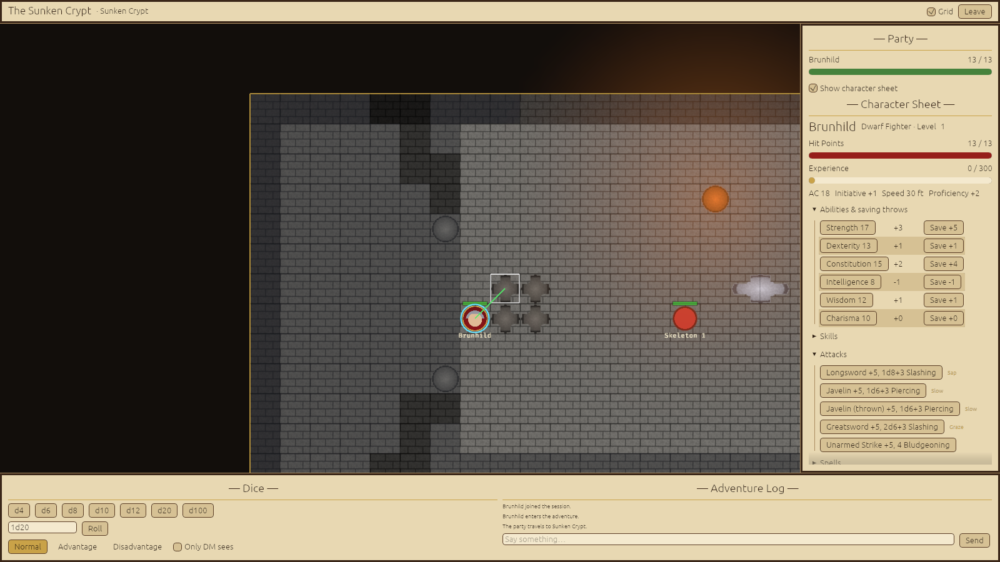
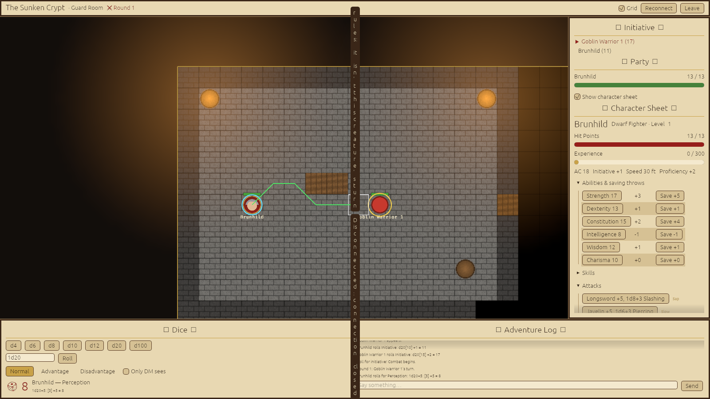

# D&D 5.5 — Multiplayer Desktop RPG Engine

A Rust desktop app for playing **fifth edition with the 2024 revised rules (SRD 5.2.1)** with friends.
The DM builds rooms on a grid, links them into a campaign graph and hosts a live session. Players join
over the network with their own characters, explore under real light and darkness, and fight
turn-based battles with animated feedback.



| Player in a dark crypt (Dwarf darkvision, pillar shadows, brazier light) | Player character sheet & dice |
|---|---|
|  |  |

## Status

This is the **first playable vertical slice**. Hosting, joining, character creation with a PNG
portrait, the map editor, monsters, dice, initiative, 2024 attack rules, opportunity attacks,
lighting/darkvision/fog of war, room travel and saving all work end to end. Spells, most class
features and many editor conveniences are still to come. See:

* [`docs/DESIGN.md`](docs/DESIGN.md): architecture and technical design
* [`docs/RULES_COVERAGE.md`](docs/RULES_COVERAGE.md): what's implemented, partial or pending
* [`docs/ROADMAP.md`](docs/ROADMAP.md): milestone checklist (and how each item was verified) and next steps
* [`docs/LEGAL.md`](docs/LEGAL.md): SRD attribution and asset licensing

## Build & run

Requirements: Rust (the pinned toolchain in `rust-toolchain.toml` installs automatically with rustup).
On Linux you also need `libasound2-dev libudev-dev libxkbcommon-dev` (plus Vulkan drivers).

```bash
cargo run --release -p dnd_desktop
```

* **Play — Quick Demo** hosts a two-room demo campaign (Guard Room → Sunken Crypt).
* **Create Campaign** hosts a blank campaign on the chosen port (default 7878).
* Players use **Join Campaign** with `DM-IP:7878` and the 6-letter code shown in the DM's top bar.
  Over the internet, use port forwarding or a private network such as Tailscale (a relay is planned).
* Saves live in `%APPDATA%\dnd55\campaigns.db` (Windows) or `~/.local/share/dnd55/` (Linux).

Controls: WASD/arrows pan · mouse wheel zooms · middle-drag pans · left-click selects your token, then
click a cell to move or a door to open it · in combat, pick an attack in the action bar, then click a
target · right-click cancels or returns to Play · DM: Shift+click teleports the selected creature.

### Windows build

The code is cross-checked for `x86_64-pc-windows-gnu`. On Windows, `cargo build --release -p dnd_desktop`
produces `target\release\dnd55.exe` (no console window in release builds). An installer is on the roadmap.

## Tests

```bash
cargo test --workspace          # 103 tests: rules, world, session, persistence, real-TCP multiplayer, client
cargo clippy --workspace --all-targets
```

Headless smoke run (two processes, screenshots):

```bash
DND55_AUTO=host DND55_SESSION_CODE=TEST42 DND55_SCREENSHOT=dm.png cargo run -p dnd_desktop &
DND55_AUTO=join DND55_SESSION_CODE=TEST42 DND55_SCREENSHOT=player.png cargo run -p dnd_desktop
```

## Workspace

| Crate | Purpose |
|---|---|
| `crates/dnd_rules` | Pure SRD 5.2.1 rules engine (no graphics/IO) |
| `crates/dnd_world` | Maps, layers, asset catalog, pathfinding, line of sight, lighting, room graph |
| `crates/dnd_session` | Authoritative session: command validation, combat, per-player hidden-info views |
| `crates/dnd_persist` | SQLite saves with checksums, migrations, autosave, backup, export/import |
| `crates/dnd_net` | TCP host/client: session codes, DM secret, resume tokens, rate limiting |
| `apps/dnd_desktop` | Bevy + egui desktop client (menus, editor, HUD, rendering, audio, i18n EN/IT) |

---

This work includes material from the System Reference Document 5.2.1 ("SRD 5.2.1") by Wizards of the
Coast LLC, available at https://www.dndbeyond.com/srd. The SRD 5.2.1 is licensed under the Creative
Commons Attribution 4.0 International License, available at
https://creativecommons.org/licenses/by/4.0/legalcode.
