# Visual Overhaul — Art Direction, Design System and Rendering

This document describes the medieval-gothic look introduced in this release, where each part lives in
the code, how it was verified, and what was *not* verified.

## Before / after (real screenshots from the running app)

All images were captured from the actual executable on a virtual display with a software Vulkan
renderer (`scripts/visual-snapshots.sh`). "Before" was captured from the previous commit's binary, built
separately, with the same scenario. Nothing here is concept art.

| Screen | Before | After |
|---|---|---|
| Main menu | 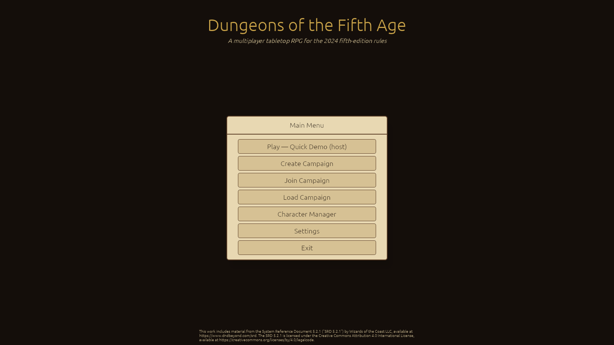 | 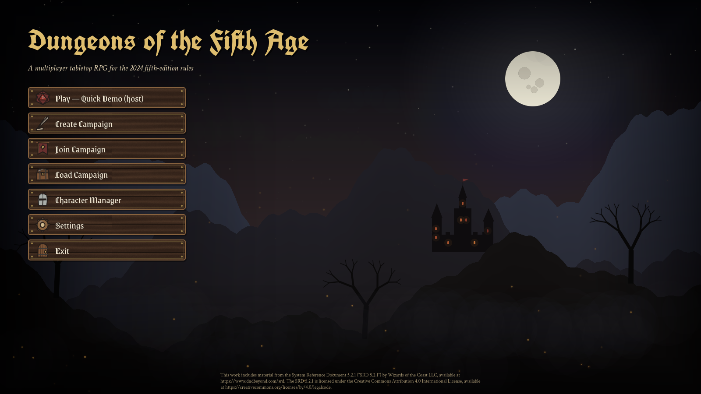 |
| Map (DM, showcase room) | 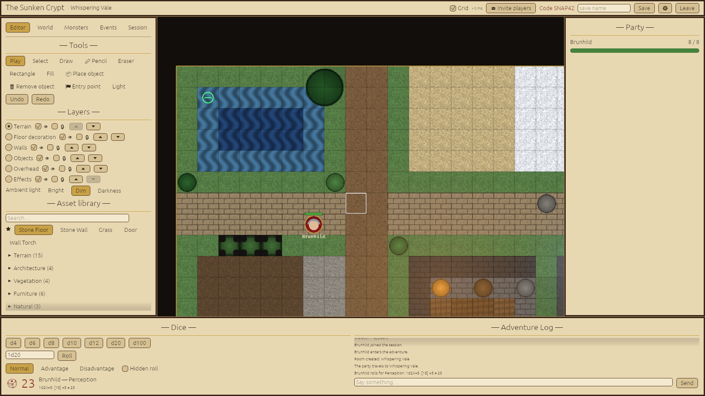 | 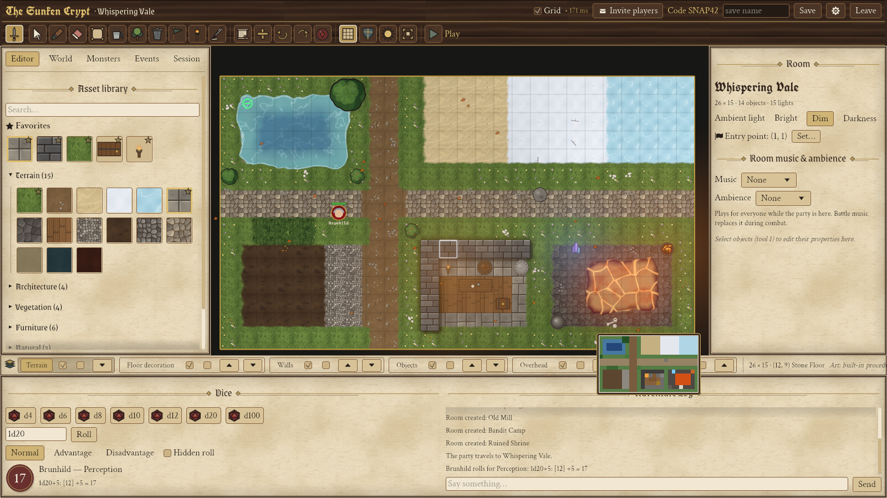 |
| Map (player view, fog of war) | 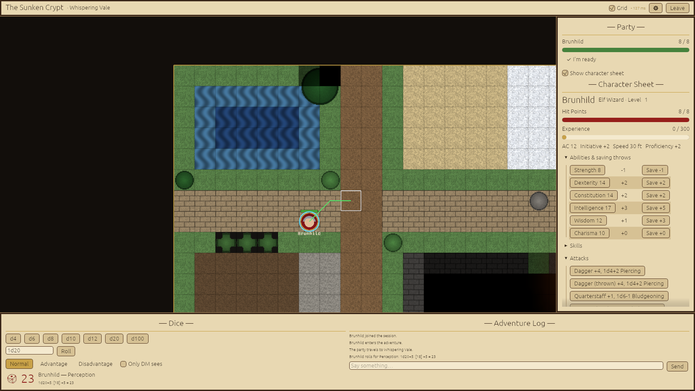 |  |
| Campaign graph | 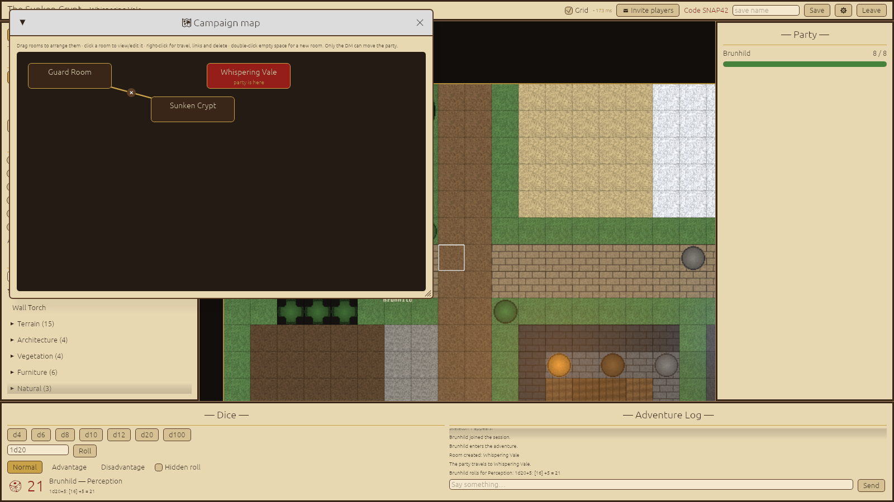 | 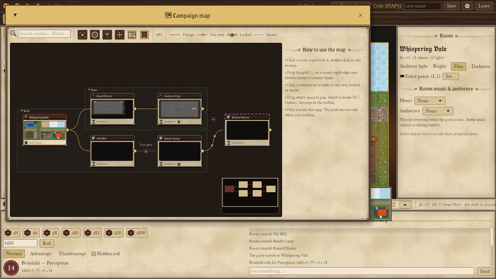 |
| Map editor | 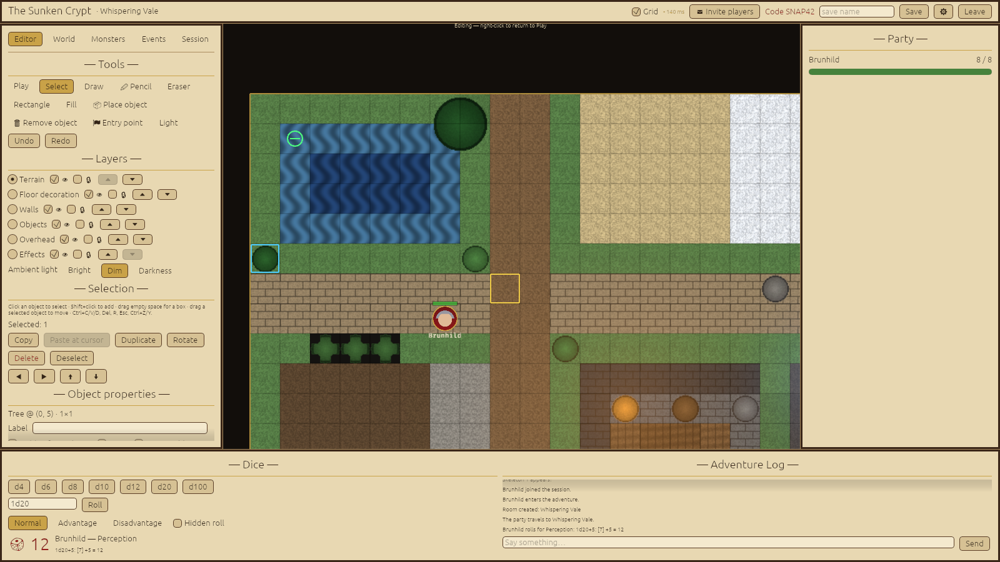 | 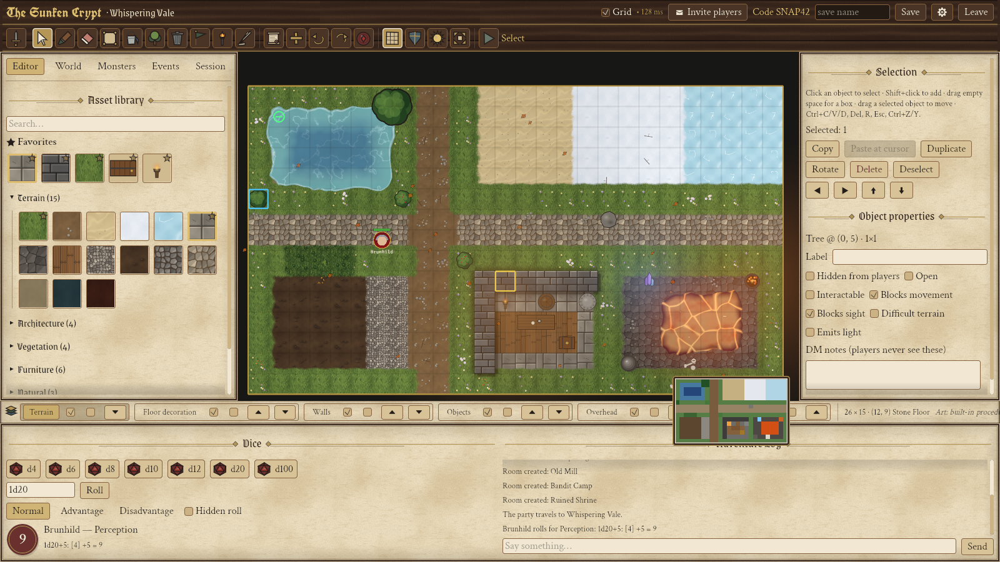 |
| Character creator | 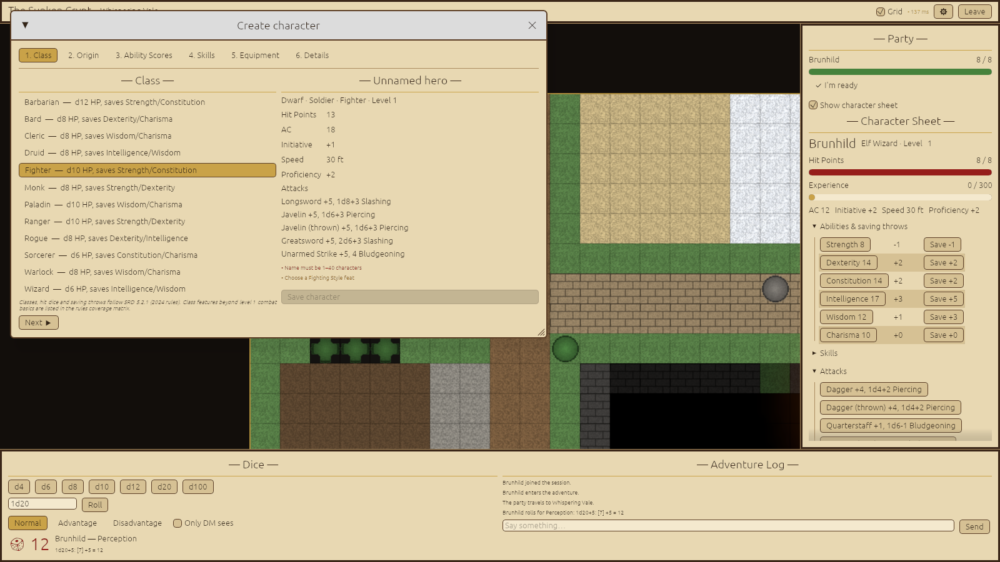 | 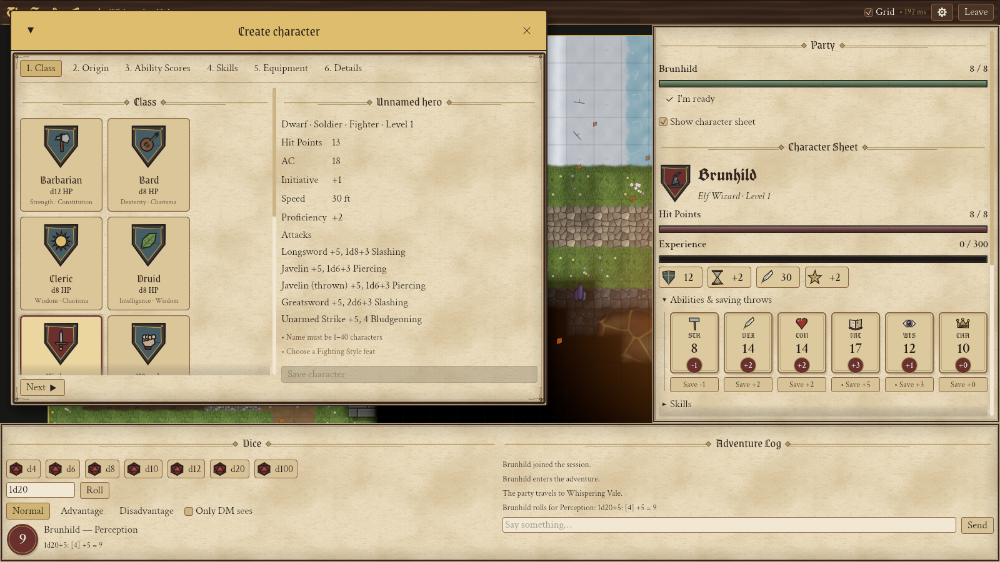 |
| Character sheet |  | 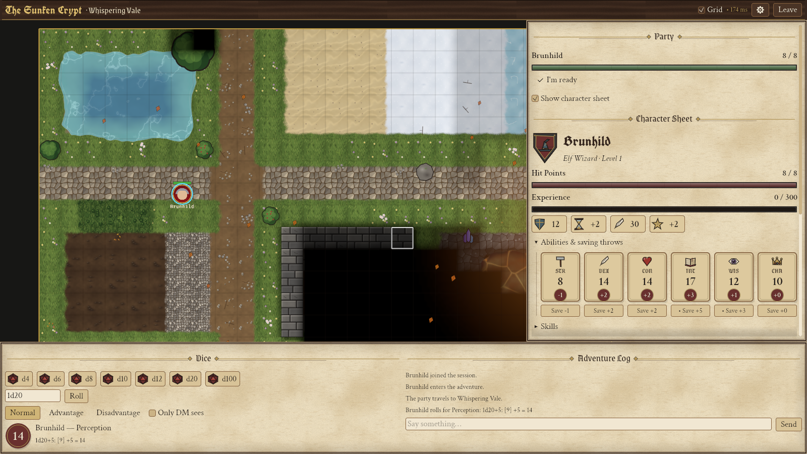 |

The showcase room (`DND55_AUTO_SCENARIO=showcase`) paints every terrain type, a pond, a lava pool, a
stone house and objects. It also adds three more rooms with regions and with locked, secret and one-way
links for the graph.

## Art direction

The two references set the direction:
* **Illustrated medieval emblems.** Thick irregular ink outlines, earthy fills, painted highlights,
  shield and banner frames, and strong silhouettes. These carry over to the icon set (`icons.rs`), the
  class emblems, the menu plaques, the banners and the map objects.
* **Blackletter calligraphy.** Used for identity text only: logo, room and campaign titles, the chapter
  reveal and big announcements. Everything else uses a readable book serif.

Nothing was copied or traced from the references: every icon, tile and object and the menu scene are
drawn by code in this repository.

## Design system (`apps/dnd_desktop/src/theme.rs`)

| Token | Value | Use |
|---|---|---|
| `BG` | #171715 | window clear color |
| `WOOD` / `WOOD_LIGHT` | #35251D / #5A402C | top bar, toolbars, plaques |
| `PARCHMENT` / `PARCHMENT_DARK` / `IVORY` | #E5D5B5 / #D0BA8F / #F1E7D2 | panels, windows, text on dark |
| `GOLD` / `GOLD_BRIGHT` / `BRONZE` | #B59654 / #DEBD6E / #88633F | borders, accents, hover |
| `BURGUNDY` | #69302E | danger, damage, party room |
| `FOREST`, `HEALTH`, `SLATE`, `MANA` | — | regions, HP bars, spell gems |
| `INK` / `INK_SOFT` | #241D1A / #5C4A3A | body text |

**Fonts** (embedded, SIL OFL 1.1, licenses in `assets/fonts/`):

| Font | Role |
|---|---|
| UnifrakturCook Bold | Blackletter display (`theme::display`, `theme::title`) |
| Grenze Gotisch | headings, window titles, buttons on plaques (`theme::gothic`) |
| Crimson Text (Regular/SemiBold/Italic) | all body text, numbers, tooltips |

All three cover àèéìòù and the other Italian accents (tested in `theme.rs`).

**Materials.** Tileable parchment, dark wood and forged iron textures are generated at startup
(`Materials`). They are painted under every window (`theme::win` + `window_bg`) and panel (`panel_bg`),
with burned-edge vignettes and an ornamental border: wood band, bronze rule, gold rule and corner
flourishes.

**Components.** These are used across screens; prefer them over ad-hoc styling:
* `heading` — gothic title with gold rules and diamonds.
* `title` — Blackletter with shadow.
* `plaque_button` — wood plaque with an emblem and animated hover glow.
* `icon_button` — toolbars.
* `icon_text_button` — action bar and dice tray.
* `stat_medallion` — ability scores.
* `stat_chip` — AC, initiative, speed, proficiency.
* `bar` / `paint_bar` — iron-framed resource bars.
* `pips` — spell-slot gems.
* `banner` — turn notifications.
* `dark_scope` — widget styling on wood.

**Icons** (`icons.rs`): 55 original vector icons. They cover menu and HUD, editor tools, the 12 classes
and the 6 abilities, plus an `emblem` frame (shield with iron rim). They are drawn as shapes, so they stay
crisp at any UI scale.

## Screens

* **Main menu** (`menu.rs`, `menu_scene.rs`). An animated painted night scene: stars, a moon with layered
  glow, three parallax mountain ranges, a castle with flickering windows, mist, rising embers and a
  vignette. On the left are the Blackletter title and the plaque menu: Continue (latest campaign), Quick
  Demo, Create, Join, Load, Characters, Settings and Exit. Sub-pages fade and slide in on the right.
* **Character creator.** Illustrated class cards (emblem, Hit Die, saving throws). The other steps
  inherit the parchment theme.
* **Character sheet.** Class emblem and Blackletter name; HP and XP iron bars (the XP bar now uses the
  real next-level threshold); stat chips; six clickable ability medallions with save buttons
  (proficient saves are marked); painted spell-slot gems.
* **Combat HUD.**
  * Initiative cards: faction token, mini HP bar or health status, initiative seal, pulsing active card.
  * Action bar: icon buttons.
  * Dice tray: a tumbling result on a wax seal.
  * A painted "Your turn" banner and a cinematic Blackletter room-title reveal.

## Map rendering (`map_render.rs`, `terrain_art.rs`, `liquid.rs`, `shaders/liquid.wgsl`, `weather.rs`, `vfx.rs`)

* **Terrain.**
  * Painterly 64 px materials for grass, undergrowth, dirt, mud, sand, snow, ice, flagstones, stone
    walls, cobbled road, gravel, rubble, cave floor, wooden floors and walls, plus river beds.
  * Each has 4 variants that share a seamless base and differ only in interior details. Low-frequency
    brightness variation across the map breaks up large areas.
* **Transitions.** Softer materials spread over their neighbours with organic noise masks. Grass spills
  over dirt and dirt over cave floor; structured floors such as flagstones, planks and roads keep crisp
  edges. These are 8-direction edge and corner masks applied per cell, a form of autotiling that needs no
  hand-made transition tiles.
* **Depth.** Ambient occlusion along walls, drop shadows from walls, soft contact shadows under objects,
  and scattered ground details (tufts, flowers, pebbles, leaves, twigs, bones).
* **Objects.** Ink-outlined top-down illustrations: trees and bushes with clustered canopies, boulders,
  crystals, tables, chairs, beds, bookshelves, barrels, crates, chests, doors, torches, braziers, altars,
  pillars, levers, pressure plates, rune circles, bones and stalagmites.
* **Water.** One quad per room is driven by a per-cell data texture. Linear sampling plus noise
  gives organic shorelines. On top of that:
  * two wave layers;
  * caustic ridges;
  * glints;
  * outward-moving ripples and foam at the shore;
  * shallow/deep color by depth;
  * translucent shallows.
* **Lava.** Drifting cooled crust plates (cellular noise) over pulsing magma, glowing seams, sparks,
  thicker crust at the edges and rising ember particles.
  * Lava is also a **real light source** (bright 5 ft, dim 10 ft), defined in the catalog and used by
    the visibility rules (unit test in `dnd_world`). Older saves get this on load.
  * Lava damage is not automatic. The DM configures it with an Events trap ("character enters an area →
    Trap with Fire damage"), so visuals and hazard rules stay independent, as requested.
* **Lighting.**
  * Glows use a smooth two-stage falloff and per-source color: warm torches, orange lava, colored
    crystals, cool white for spells and DM lights, with flicker.
  * **Fog of war** is a soft texture (8 px per cell). A cell only ever darkens towards a *darker*
    neighbour, so an unseen cell is never uncovered (unit test). Rendering visualises the host's
    authoritative visibility and never changes it.
* **Atmosphere.** The DM picks it per room (Session tab → Atmosphere): rain, snow, fog, falling leaves,
  floating dust, embers, fireflies, magical motes or ash, with an intensity slider. It is cosmetic only.
* **Combat effects.**
  * Typed particle bursts for fire, cold shards, lightning (jagged bolts), radiant rays, necrotic wisps,
    poison and acid, force and thunder shock rings, healing sparkles, protective rings and light.
  * Slash arcs for melee hits.
  * Damage numbers in the book serif with a dark under-print. Critical hits are larger, marked with "!",
    get a ring and a short camera shake.
  * Effects are short and small so the grid stays readable.
* **Camera.** It frames the room in the free space between panels when you enter it, and zoom is smooth.

## Map editor (`editor_ui.rs`)

* **Top toolbar.** Every tool has an icon and a number-key shortcut (1 Select … 0 Draw; Esc returns to
  Play), next to copy, paste, undo, redo and save (Ctrl+S). It also holds the grid, collision overlay
  (✖ blocks movement, □ blocks sight, • difficult) and light-radius overlay toggles, plus Fit and
  **Preview**, which hides the editor to see the map as it plays.
* **Left palette.** Thumbnails generated from the real art, search, favorites (right-click), recently
  used assets, collapsible categories and tool options (paint layer, light radii, hidden objects,
  drawing options).
* **Right inspector.**
  * With a selection: the selection actions and properties (label, hidden, open, interactable,
    collision, light, DM notes, container loot).
  * Otherwise: the room's properties (size, objects, lights, ambient light, entry point, music,
    ambience, atmosphere).
* **Bottom status bar.** Layers (select, visible, locked, order) and the map size plus the cursor cell
  and its terrain.
* **On the map.**
  * A translucent placement preview of the selected asset.
  * A minimap of the room with the camera rectangle; click to jump.
  * A right-click context menu on objects (copy, duplicate, rotate, delete).

## Campaign graph (`graph_editor.rs`)

* **Room cards.** Each card shows the map thumbnail (computed by the host for the DM only), a type icon
  (outdoor, cave, dungeon, building, water) and status badges: party here, visited or unexplored,
  unreachable from the party's room, and monster count.
* **Connection styles.** Curved links are recognisable **by shape**, with color only as a secondary cue:
  * solid line — normal passage;
  * arrowheads — one-way;
  * double line with a lock emblem — locked;
  * dashed line with an eye emblem — secret.

  Secret rooms have a dashed card border.
* **Creating connections.** Drag from a card's gold ◆ port onto another card.
* **Editing.** Click a link to set one-way, locked, secret or label, or delete it. Click a card to
  preview it, rename it, set region, chapter or secret, edit its map, see its connections or delete it.
  Double-click to open the room in the editor.
* **Navigation.** Wheel zoom around the cursor, drag to pan, Fit, Center on party, Auto-arrange (layered
  by distance from the party room, with barycentre ordering and no overlaps; unit test), minimap, search
  (Enter jumps to the room), and region groups that collapse into a single card.
* **Moving the party.** It happens only through a confirmation dialog that says whether an open, locked
  or no passage exists. The DM override is explicit.
* **Privacy.** The graph editor and room cards exist only in the DM's view. Players still receive only
  the rooms they have visited, with secret links and DM notes removed (unit test checks the serialized
  player view for leaks).

## Settings and accessibility (Settings window)

* **Graphics quality.** Low, Medium, High and Ultra each change real work:

  | Effect | Low | Medium | High | Ultra |
  |---|---|---|---|---|
  | Ground details (relative density) | off | 50% | 100% | 150% |
  | Transitions, shadows/AO, soft fog | off | on | on | on |
  | Weather/VFX particles | ×0.25 | ×0.6 | ×1 | ×1.6 |
  | Water/lava noise octaves | 2 | 3 | 4 | 5 |

* **Reduced motion.** Stills the menu scene, water and lava, weather particles, shake, glow flicker,
  the chapter-reveal motion and UI animations. Combat bursts become fewer and slower but still show
  what happened.
* **FPS cap.** 30, 60, 120, 144 or unlimited, alongside the existing resolution, window mode, VSync, UI
  scale and volumes.

## Verification and limits (honest)

* **Verified.**
  * Builds; 163 automated tests pass; clippy reports 0 warnings.
  * Real-mouse GUI test passes: spellbook → Fire Bolt → goblin, and bestiary → drag a monster onto the
    map.
  * All screenshots above come from the running app (Linux, software Vulkan).
  * The Windows `.exe` was run under Wine; see the release notes.
* **Not verified.**
  * A real GPU on Windows, including DirectX 12 compiling the WGSL water/lava shader (Wine's DX12 fails
    and the game falls back to Vulkan there).
  * Performance on low-end hardware. The quality presets exist for that, but frame times were not
    measured on real machines.
  * Audio output (no sound device in the build environment).
* The art is procedural. It is original and consistent, but it is not hand-painted AAA artwork. Asset
  packs with proper licenses can replace any tile or object through the catalog's `sprite` field.
